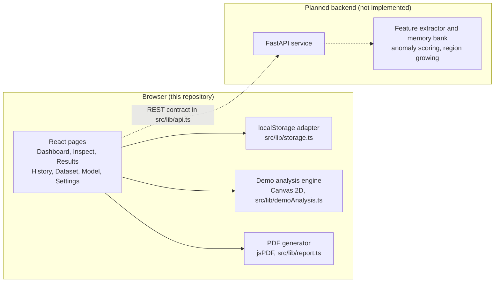
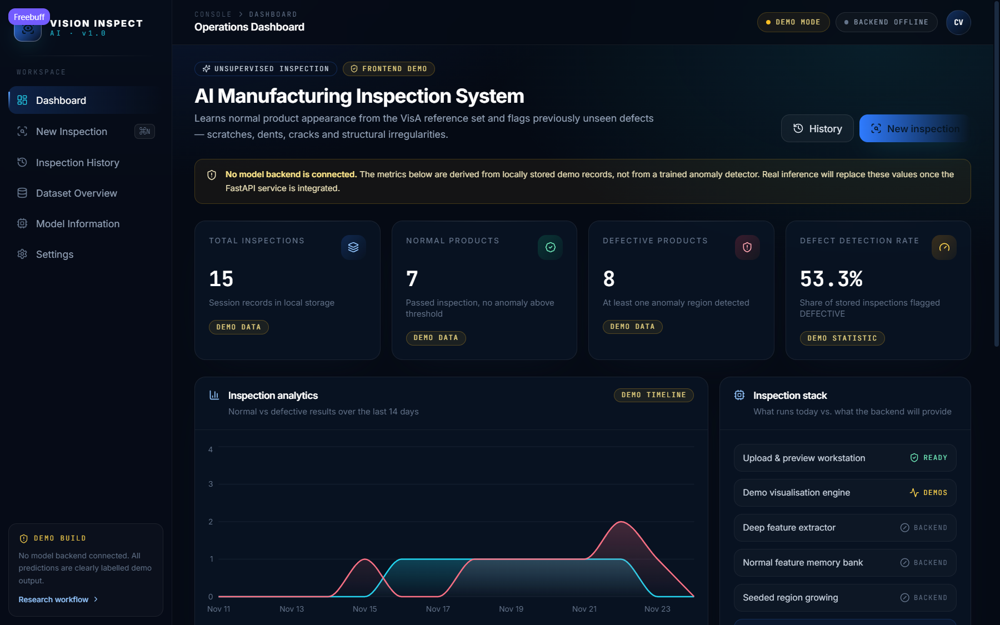
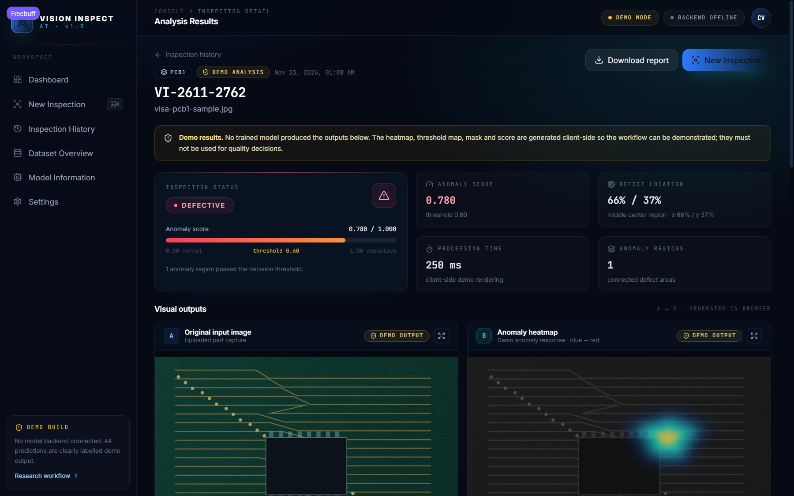
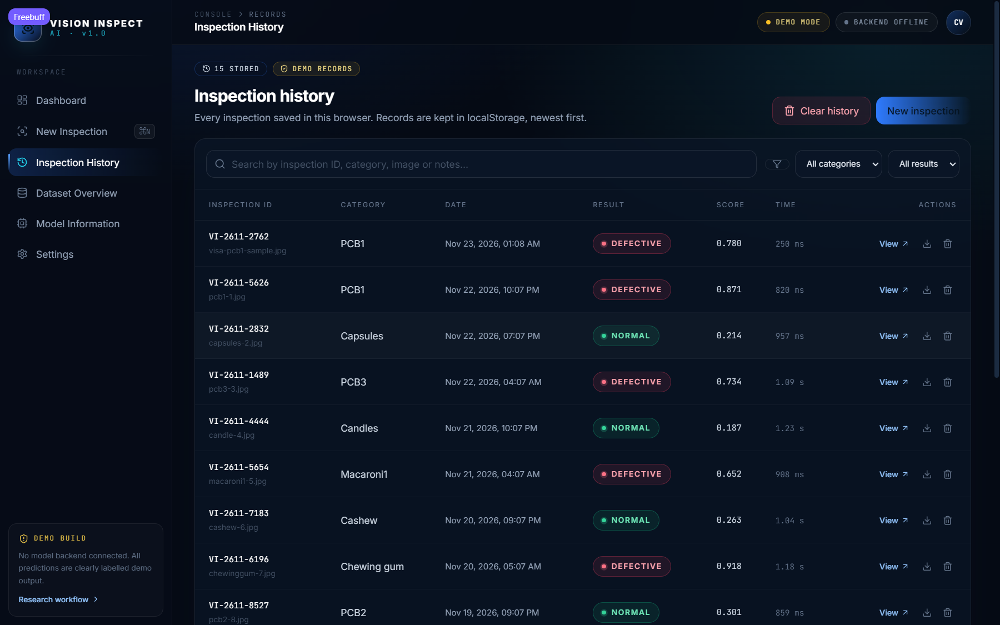
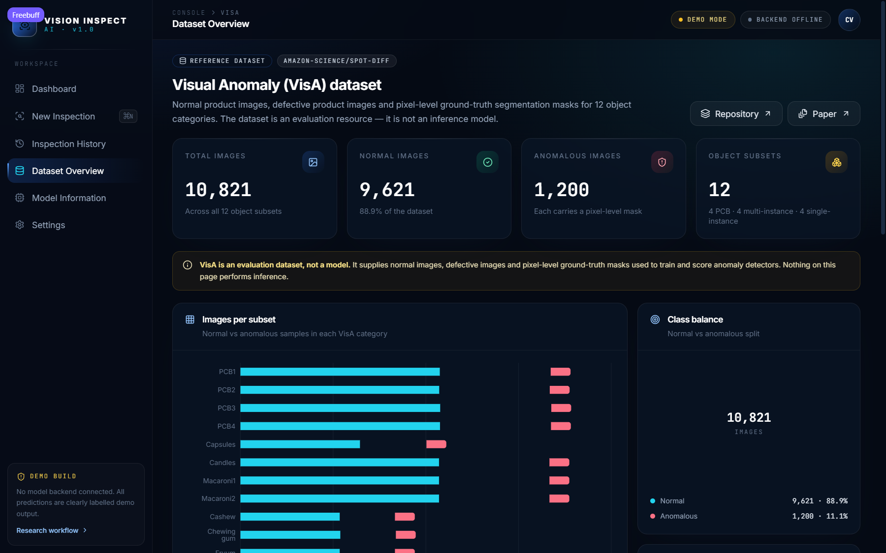

# VISION INSPECT AI

**AI-Powered Industrial Defect Inspection Dashboard**

An operator console for unsupervised visual anomaly detection on manufactured parts, built around the
[VisA](https://github.com/amazon-science/spot-diff) (Visual Anomaly) benchmark. The interface covers the
complete inspection workflow — image capture, category selection, anomaly visualisation, segmentation
review, history, PDF reporting — and is prepared to talk to a FastAPI anomaly-detection service.

> **Live demo:** https://vision-inspect-ai-dkvvr8.freebuff.site

---

## ⚠️ Demo status — please read first

**The inspection engine in this repository is a browser-based DEMO implementation.**
It does **not** run PatchCore, SPot-the-Difference, or any other trained model.

- Heatmaps, threshold maps and defect masks are generated **deterministically in the browser** from the
  uploaded image (seeded elliptical heat fields, colour mapping, thresholding and region extraction).
  They are not model predictions.
- Anomaly scores, defect labels and confidence values are simulated for interface evaluation only.
- Seeded history records are synthetic summary rows created on first load.
- The FastAPI contract in `src/lib/api.ts` describes the intended backend, but no backend is connected.

Every screen that shows generated content labels it as **DEMO**. Nothing in this project should be used to
accept or reject real production parts.

---

## 1. Overview

VISION INSPECT AI is a single-page React dashboard for an unsupervised visual anomaly-detection workflow on
industrial and consumer-product imagery. It provides the operator-facing half of such a system: a workstation
for submitting a part image, a results console with four synchronised visual outputs, a searchable inspection
history, a dataset explorer for the 12 VisA subsets, a model/research reference page, and PDF report export.

The project exists so the full user experience can be designed, demonstrated and evaluated before — and
independently of — the deep-learning service that will eventually produce the anomaly maps.

---

## 2. Problem statement

Visual quality inspection on production lines is still largely manual. Human inspectors are slow, fatigued by
repetitive visual work, and inconsistent between shifts and sites. Supervised defect detectors require large
labelled defect datasets, but real defects are rare, varied and expensive to label.

Unsupervised anomaly detection addresses this: a model learns only what *normal* parts look like and flags
anything that deviates. Deploying such a system needs more than a model — operators need a clear, fast
interface that shows where the anomaly is, how confident the system is, and what happened historically.

This project builds that interface, so the detection pipeline can be plugged in behind a stable contract.

---

## 3. Objectives

1. Provide an end-to-end operator workflow: upload → configure → analyse → review → report.
2. Visualise anomaly information at four levels: original input, continuous heatmap, thresholded map and
   final segmented mask.
3. Make unsupported or simulated functionality unmistakable, so the tool is never mistaken for a working
   detector.
4. Model the real system architecture — preprocessing, feature extraction, normal-feature memory bank,
   anomaly scoring, thresholding, seeded region growing, mask generation — in the UI.
5. Define a concrete REST contract (`src/lib/api.ts`) that a FastAPI backend can implement without any
   front-end rewrite.
6. Cover the full VisA category set (12 subsets) and support optional ground-truth mask comparison
   (IoU / precision / recall) for research evaluation.
7. Keep the whole thing deployable as free static hosting — no server, database or GPU required to run the demo.

---

## 4. Key features

### Dashboard
- KPI cards: total inspections, normal, defective, defect rate.
- 14-day normal-vs-defective area chart (Recharts).
- Inspection-stack readiness panel showing which stages are implemented and which await the backend.
- Recent-inspection table with direct links to results.
- VisA reference-dataset summary and inspections-by-category bar chart.

### Inspection workstation (`/inspect`)
- Drag-and-drop or browse upload (JPG/JPEG/PNG), preview, replace and remove.
- Optional "Load sample" that draws a synthetic PCB board in-canvas — works fully offline.
- VisA category selector, optional custom inspection ID, operator notes.
- Live processing-pipeline strip with per-stage progress.
- Optional ground-truth mask upload for mask comparison.
- Threshold shown from Settings and applied to each run.

### Results console (`/inspections/:id`)
- Four image panels: original, anomaly heatmap, thresholded anomaly map, final defect mask — each expandable
  to a lightbox.
- Status, anomaly score vs threshold, processing time, region count.
- Detected-region table: label, location, area, confidence.
- Pipeline trace and mask-comparison metrics when a ground-truth mask was supplied.
- One-click PDF report download.

### History (`/history`)
- Full local record list with text search, status filter and category filter.
- Sortable metadata, per-record PDF export, single-record delete and clear-all (with confirmation).
- Rows link straight to the results console.

### Dataset explorer (`/dataset`)
- VisA totals (normal / anomalous split), per-subset bar chart, share pie chart.
- Subset detail card: normal and anomalous counts, anomaly classes, object group, folder.
- Notes on dataset licensing and usage.

### Model information (`/model`)
- Seven-stage research workflow explanation with the reasoning behind each stage.
- Implemented-vs-pending checklist for the detection pipeline.
- Explicit statement that no inference runs in this build.

### Settings (`/settings`)
- API base URL (persisted in `localStorage`, overrides `VITE_API_BASE_URL`).
- Decision threshold slider, default category, image-retention toggle.
- Backend connection test against `GET /health`.
- Local storage usage summary and reset actions.

### Cross-cutting
- Dark, industrial console UI (Tailwind CSS), fully responsive down to 390 px with an off-canvas nav drawer.
- Client-side PDF reports via jsPDF, including a demo disclaimer on every page.
- Records persist in `localStorage`; only the newest four keep image payloads to stay inside browser quota.

---

## 5. Technology stack

| Area | Choice |
| --- | --- |
| Framework | React 18 + TypeScript 5 |
| Build tool | Vite 5 |
| Routing | React Router 6 (`BrowserRouter`) |
| Styling | Tailwind CSS 3 + PostCSS + Autoprefixer |
| Charts | Recharts 2 |
| Icons | lucide-react |
| PDF export | jsPDF 2 |
| Image processing | Canvas 2D API (browser) |
| Persistence | Web Storage (`localStorage`) |
| Planned backend | FastAPI + Python (PyTorch anomaly-detection service) — **not included** |
| Hosting (live demo) | Cloudflare Workers static assets (Freebuff Sites) |

No state-management library, UI kit or CSS-in-JS dependency is used; the UI is composed from local components
in `src/components/ui.tsx`.

---

## 6. Project architecture



**Layered structure**

| Layer | Location | Responsibility |
| --- | --- | --- |
| Presentation | `src/pages/`, `src/components/` | Screens, panels, tables, charts, layout and navigation |
| Domain | `src/types.ts` | Inspection record, region, mask-comparison and settings types; VisA catalogue |
| Services | `src/lib/` | Demo analysis, persistence, PDF report, API client, formatting helpers |
| Hosting | `worker.js`, `sites.manifest.json` | Minimal static-asset Worker with SPA fallback for the live deployment |

**Request flow for an inspection:** `NewInspection` validates the file → `runDemoAnalysis()` decodes it on a
canvas, builds the heat field, renders heatmap/threshold/mask, extracts regions → the `Inspection` record is
persisted by `upsertInspection()` → the router navigates to `/inspections/:id`, which rehydrates the record from
storage. When the backend is integrated, `src/lib/api.ts` replaces the demo call and the rest of the flow is
unchanged.

---

## 7. Folder structure

```
vision-inspect-ai/
├── index.html                 # Vite HTML entry point
├── package.json               # Scripts and dependencies
├── package-lock.json          # Locked dependency tree
├── vite.config.ts             # Vite config + "@" path alias
├── tsconfig.json              # TypeScript compiler options
├── tailwind.config.js         # Design tokens (brand / aqua palettes, fonts)
├── postcss.config.js          # Tailwind + autoprefixer pipeline
├── worker.js                  # Static-asset Worker with SPA fallback (deployment only)
├── sites.manifest.json        # Freebuff Sites deploy manifest
├── LICENSE
├── README.md
└── src/
    ├── main.tsx               # React root, BrowserRouter, demo seeding
    ├── App.tsx                # Route table
    ├── index.css              # Tailwind layers, base styles, utility classes
    ├── types.ts               # Domain types + VisA dataset catalogue
    ├── components/
    │   ├── Layout.tsx         # Shell: sidebar, mobile drawer, top bar
    │   ├── ImageDropzone.tsx  # Upload, validation, preview
    │   ├── Pipeline.tsx       # 8-stage processing pipeline strip
    │   └── ui.tsx             # Panel, Badge, Button, Field, StatCard, dialogs…
    ├── lib/
    │   ├── api.ts             # FastAPI contract client (not yet connected)
    │   ├── demoAnalysis.ts    # Deterministic browser demo engine
    │   ├── report.ts          # jsPDF inspection report
    │   ├── storage.ts         # localStorage repository + demo seed data
    │   └── utils.ts           # Formatting, ID generation, class merging
    └── pages/
        ├── Dashboard.tsx      # KPIs, charts, recent activity
        ├── NewInspection.tsx  # Workstation
        ├── Results.tsx        # Results console
        ├── History.tsx        # Searchable history
        ├── Dataset.tsx        # VisA explorer
        ├── ModelInfo.tsx      # Research workflow reference
        ├── Settings.tsx       # Operator settings + backend test
        └── NotFound.tsx       # 404
```

---

## 8. Installation

**Prerequisites:** [Node.js](https://nodejs.org/) 18 or newer (20 LTS recommended) and npm 9+.

```bash
# 1. Clone the repository
git clone https://github.com/<your-username>/vision-inspect-ai.git
cd vision-inspect-ai

# 2. Install dependencies
npm install

# 3. Start the development server
npm run dev
```

Open the URL printed by Vite (default **http://127.0.0.1:5173**).

### Available scripts

| Command | Description |
| --- | --- |
| `npm run dev` | Start the Vite dev server with hot module replacement |
| `npm run build` | Type-check (`tsc --noEmit`) and produce a production build in `dist/` |
| `npm run preview` | Serve the production build locally on port 4173 |
| `npm run typecheck` | Type-check without emitting files |

### Optional environment variable

```bash
# .env.local
VITE_API_BASE_URL=http://localhost:8000
```

This sets the default backend origin. A value saved in **Settings → API base URL** takes precedence at runtime.
No environment variable is required to run the demo.

---

## 9. Running locally

1. `npm install` once.
2. `npm run dev` — the console is available at `http://127.0.0.1:5173`.
3. `npm run build && npm run preview` to check the production bundle.

Because it is a client-side SPA using `BrowserRouter`, a plain static server must fall back to `index.html` for
unknown paths (otherwise direct navigation to `/history` returns 404). `npm run preview` and the included
`worker.js` both do this.

To reset all local demo data, open **Settings → Clear inspection history**, or clear site data for the origin.

---

## 10. Using the dashboard

1. **Dashboard** — read the KPIs and the 14-day chart. Every figure is derived from locally stored demo records.
2. **New inspection** — open `/inspect`.
   - Drag an image into the dropzone, or click **Load sample** to generate a synthetic PCB image offline.
   - Pick the VisA category the part belongs to (default `PCB1`).
   - Optionally set an inspection ID and operator notes.
   - Optionally upload a VisA ground-truth mask to compare against the demo mask.
   - Press **Analyse image**. The pipeline strip animates through eight stages.
3. **Results** — clicking through to `/inspections/:id` shows status, anomaly score vs threshold, processing
   time and regions, plus the four visual panels. Use the expand icon for a full-screen view, and
   **Download report** for a PDF.
4. **History** — search by ID, category, filename or note; filter by status or category; export or delete
   records. Deleting is immediate and local.
5. **Dataset** — explore the 12 VisA subsets, counts and class groupings.
6. **Model** — review the intended research workflow and what remains to be implemented.
7. **Settings** — set the API base URL, decision threshold and default category; run the backend connection
   test; inspect storage usage; clear local history.

---

## 11. Screenshots

All screenshots below were captured from the live demo at
**https://vision-inspect-ai-dkvvr8.freebuff.site** (desktop viewport, 1440 × 900). They show **demo output**:
every view carries a `DEMO MODE`, `DEMO DATA` or `DEMO OUTPUT` badge, and the figures come from seeded local
records rather than from a trained model.

### Dashboard — KPIs, analytics and recent activity



### Results console — anomaly score, regions and the visual outputs



### Inspection history — search, filters and report export



### Dataset explorer — VisA subsets and class balance



> Not captured yet: the New Inspection workstation and the mobile layout. The remaining views can be added
the same way, as `docs/screenshots/inspect.png` and `docs/screenshots/mobile.png`.

---

## 12. Live deployment

> **https://vision-inspect-ai-dkvvr8.freebuff.site**

The demo is a static build of this repository served by a minimal Cloudflare Worker that falls back to
`index.html` for client-side routes, so deep links such as `/history` and `/inspections/<id>` work directly.
Hosting is free and requires no account, backend or API key.

Two artefacts support that deployment and are intentionally committed:

- `worker.js` — serves `env.ASSETS` and rewrites non-asset 404s to `/`.
- `sites.manifest.json` — deploy manifest (`assetsDirectory: "./dist"`, `spa: true`).

They are deployment configuration only and do not affect `npm run dev`. Any static host that supports SPA
fallback (Cloudflare Pages, Netlify, Vercel, GitHub Pages with a redirect rule) can host the same `dist/` output.

---

## 13. Current limitations

- **No real AI inference.** Heatmaps, threshold maps, masks, scores, labels and confidences are deterministic
  browser-generated demo output. PatchCore-style feature extraction, the normal-feature memory bank, anomaly
  scoring and seeded region growing are all **not implemented**.
- **No backend.** `src/lib/api.ts` defines the REST contract but no service exists; the Settings connection
  test will report the backend as unreachable.
- **No accounts or server persistence.** Records live in the visitor's `localStorage` only — they are per
  browser and per device, and are not shared between users.
- **No image storage beyond the browser.** Only the newest four records retain imagery; older records keep
  summary metadata only, and clearing site data removes everything.
- **Dataset is reference metadata.** The 12 VisA subsets and their counts are described in the UI; no dataset
  images or annotations are bundled or downloaded.
- **Single-image workflow.** No batch/queue processing, camera or line-integration input.
- **No automated tests.** Verification is type-checking plus manual review.
- **Bundle size.** The single production chunk is roughly 1.1 MB (about 325 kB gzipped); code-splitting has not
  been applied.
- **PDF reports** are generated client-side with jsPDF and are demonstration artefacts, not quality records.

---

## 14. Future enhancements

1. **Implement the FastAPI service** for the documented endpoints (`/api/inspections`, `/analyze`, `/heatmap`,
   `/mask`, `/report`, `/health`) and switch the workstation from the demo engine to real inference.
2. **PatchCore / SPot-the-Difference backbone** with a per-category normal-feature memory bank, coreset
   subsampling and k-NN anomaly scoring.
3. **Calibrated thresholds** per category, derived from normal validation splits, exposed in the UI.
4. **True seeded region growing** over the model's anomaly map, with region statistics and confidence.
5. **Server-side persistence** (PostgreSQL + object storage) so history is shared across operators and devices.
6. **Batch and stream processing** — folder upload, queue status, line/camera integration.
7. **Evaluation mode** — a full VisA benchmark run reporting image-level AUROC, pixel-level AUROC, PRO and IoU
   against ground-truth masks.
8. **Role-based access**, audit trail and immutable inspection records for production use.
9. **Performance work** — route-level code splitting, Web Worker offloading for canvas processing, virtualised
   history tables.
10. **Accessibility and i18n** — keyboard-first navigation, WCAG AA audit, localisation.
11. **Automated testing** — Vitest unit tests for the analysis/storage/report modules and Playwright smoke tests
    for the core workflow.

---

## 15. License

Released under the [MIT License](LICENSE).

The VisA dataset, the SPot-the-Difference reference implementation and any third-party model weights are **not**
included in this repository and remain subject to their own licenses and terms of use.

---

### Acknowledgements

- [VisA — Visual Anomaly Dataset](https://github.com/amazon-science/spot-diff) (Amazon Science)
- [React](https://react.dev/), [Vite](https://vite.dev/), [Tailwind CSS](https://tailwindcss.com/),
  [Recharts](https://recharts.org/), [lucide](https://lucide.dev/), [jsPDF](https://github.com/parallax/jsPDF)
